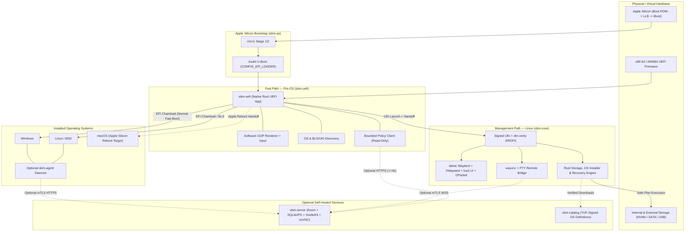
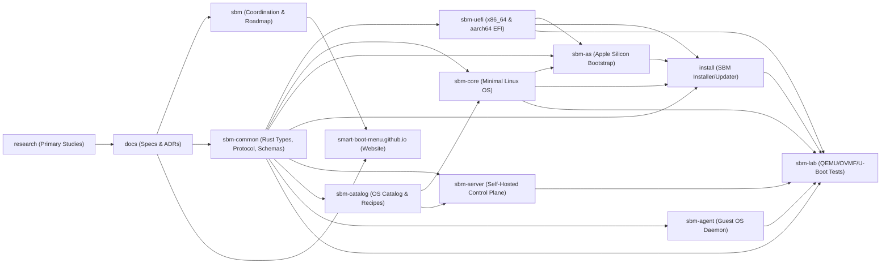
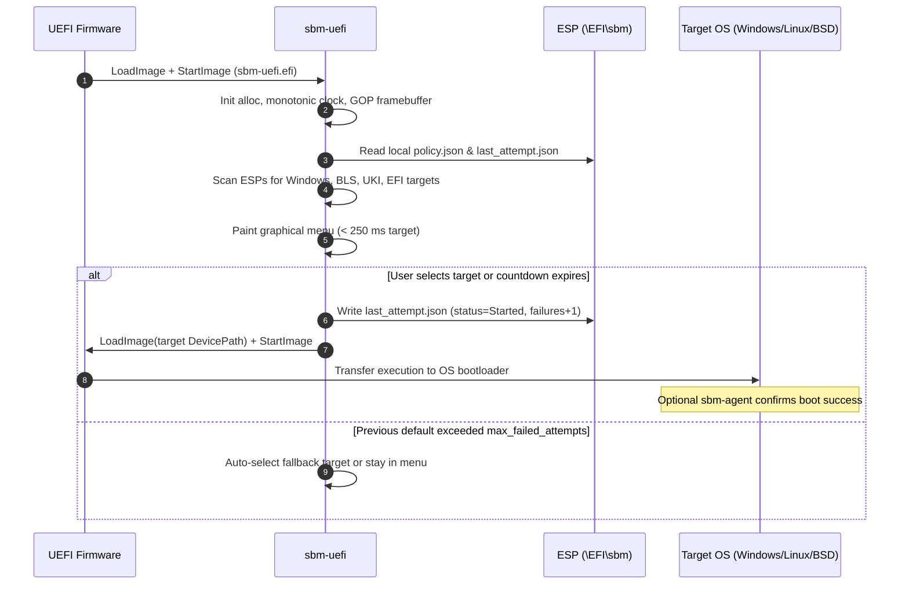
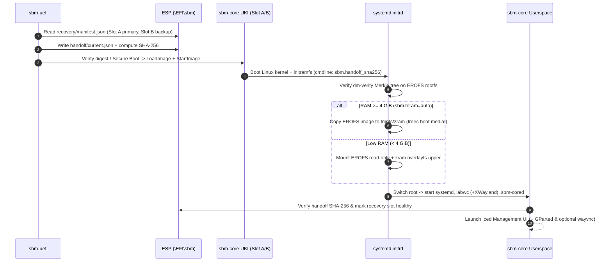
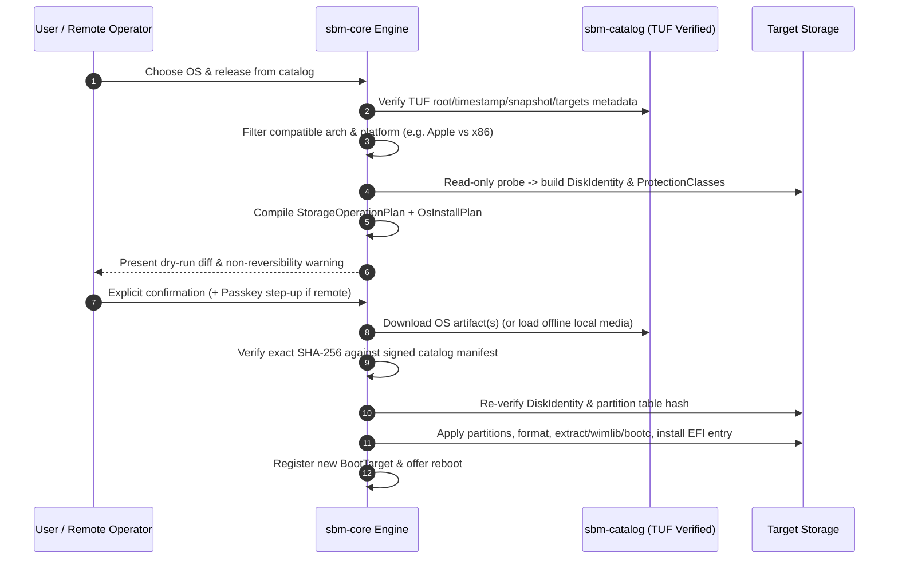
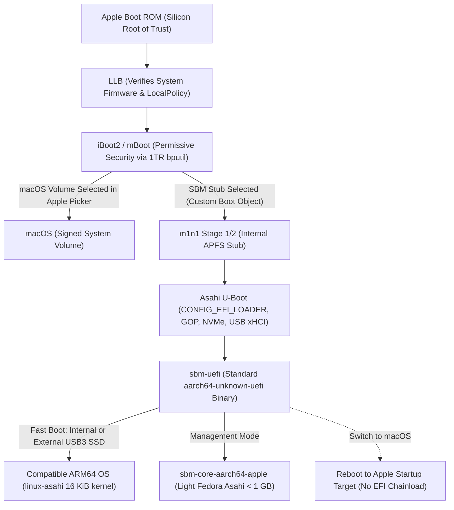
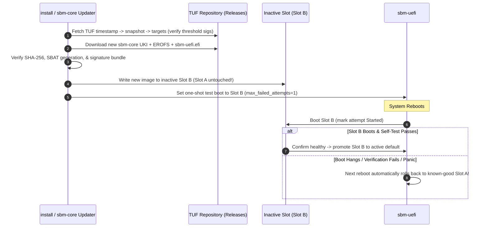
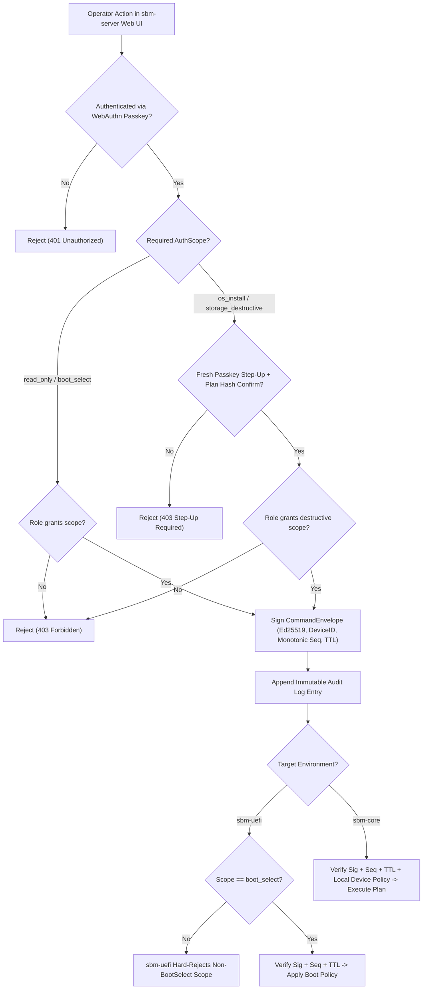
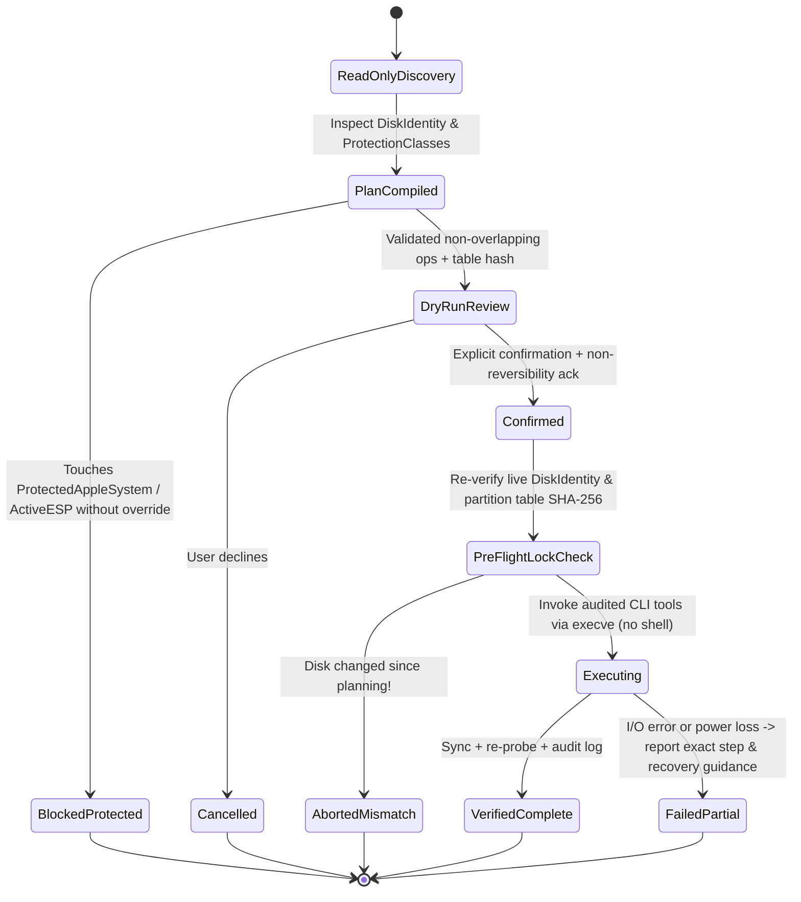

# Smart Boot Menu — System Architecture & Workflow Diagrams

**Last updated:** 2026-11-26  
All 10 canonical architecture, dependency, boot, installation, security, and storage lifecycle diagrams for Smart Boot Menu.

---

## 1. Overall Architecture



---

## 2. Repository & Component Dependency Graph



---

## 3. Normal Boot Sequence (Fast Path — No Linux Initialized)



---

## 4. Remote Boot Selection Sequence (Bounded & Offline-Safe)

```mermaid
sequenceDiagram
    autonumber
    participant OP as Operator (Web/Passkey)
    participant SRV as sbm-server
    participant UEFI as sbm-uefi
    participant ESP as ESP (\EFI\sbm)
    participant OS as Selected OS

    OP->>SRV: Select next boot target (scope=boot_select)
    SRV->>SRV: Sign CommandEnvelope (Ed25519, seq=N, TTL)
    Note over UEFI: Device powers on / reboots
    UEFI->>ESP: Check allow_remote_boot_select & pinned keys
    alt Enrolled & NIC Link Up
        UEFI->>SRV: HTTPS GET /v1/devices/{id}/boot-policy (timeout <= 4s)
        alt Valid Response Within Timeout
            SRV-->>UEFI: Signed CommandEnvelope (seq=N, target=X)
            UEFI->>UEFI: Verify Ed25519 sig, device_id, seq > last_seq, scope==boot_select
            UEFI->>ESP: Persist last_seq=N & mark one_shot consumed
            UEFI->>OS: Chainload target X
        else Timeout / Offline / Invalid Signature
            UEFI->>UEFI: Log diagnostic & fall back seamlessly to local policy
        end
    else Offline or User Pressed Local Key
        UEFI->>UEFI: Skip network immediately; follow local user/policy
    end
```

---

## 5. Recovery Environment Startup (`sbm-core`)



---

## 6. OS Installation Workflow



---

## 7. Apple Silicon Boot Sequence (`sbm-as`)



---

## 8. Secure Software Update Workflow (TUF + A/B Rollback)



---

## 9. Remote Authorization Workflow (Scoped & Step-Up Verified)



---

## 10. Storage Operation Lifecycle (Safety-First Execution)


